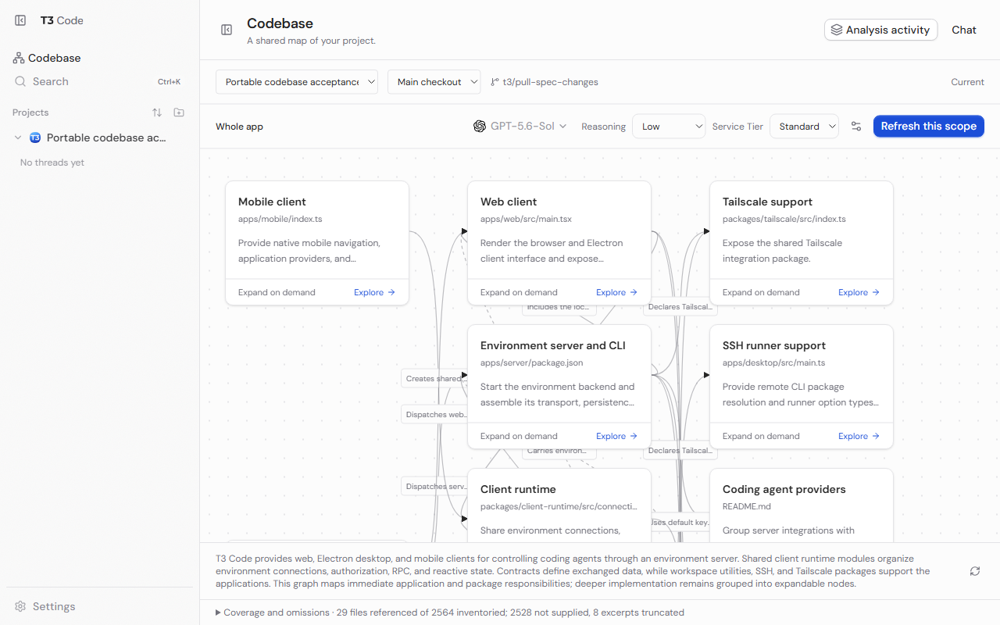
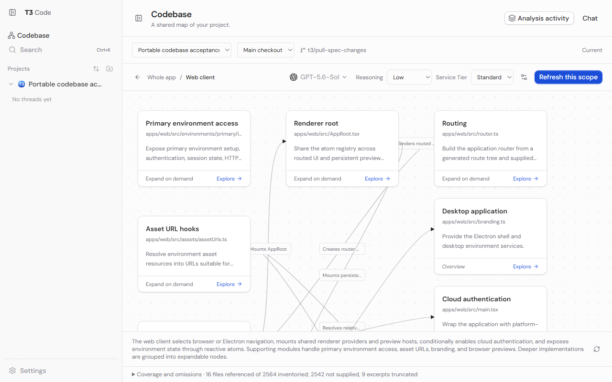

# Codebase explorer acceptance — 2026-10-25

The web client completed real Codex overview and detail analysis, source inspection, cancellation, and reopening committed maps in a second isolated environment. Native mobile, Electron shell, and deployed relay/tunnel acceptance remain unverified. This report distinguishes those limits from deterministic integration checks.

## Environment and provider

- Implementation branch: `t3/pull-spec-changes`, based on specification commit `d8472b0e6a7ef6d28e7e4c5fa168bf526e676f60`. Initial implementation: `ff9fdebf6286f1f7eaa210f5fad70a929aaf550b`; acceptance fixes accompany this report.
- Windows, Node 24.18.1, production web bundle in the T3 collaborative browser at 1280 × 800. Separate test servers used ports 8560 and 8562 with worktree-owned T3 homes. Neither used the live userdata database.
- Explicitly selected provider instance: `codex`; model: `gpt-6.1-sol`; options: `[{"id":"reasoningEffort","value":"medium"}]`. Service tier remained the standard default. These were real provider calls through the normal orchestration pipeline.
- Analysis inspected a separate full T3 Code clone of source commit `d8472b0e6a7ef6d28e7e4c5fa168bf526e676f60`, with 2,564 inventoried files after exclusions. The final refresh ran at `9d70e78e11c3a341da6ea5bc624b35ef6e8e1f7e`, which added only earlier map documents; source content was unchanged.
- Refreshed maps were committed only in the disposable source clone at `1cf54b9fbe1e2ca66f3dda9185c824c0c6357be2`. No application branch, map, or PR was pushed.

## Live results

| Check              | Observed result                                                                                                                                                                                                                                                                                                                 |
| ------------------ | ------------------------------------------------------------------------------------------------------------------------------------------------------------------------------------------------------------------------------------------------------------------------------------------------------------------------------- |
| Overview           | Successful run `codebase-77419e61cff8416e51bfe65b5b41e537`; 12 nodes, 23 edges, 29 referenced files, 2,528 files not supplied, 8 truncated excerpts.                                                                                                                                                                            |
| Web-client detail  | Successful run `codebase-f3c458d91aea2116f2a4b0ed6833805e`; scope `scope_n_1a148f8245f9cfe1401d2331`; 13 nodes, 12 edges, 16 referenced files, 2,542 files not supplied, 9 truncated excerpts. Boundary nodes resolve to the parent overview.                                                                                   |
| Accepted revisions | Overview `6ed1be40c37c5be8fb61aef162893cb7d87b96bc14719321eb31e0e51d150862`; detail `6b5676192bb1a2d87aa64da95e1ddd67110b6f07b644b705e69aa494f07fd3da`. Both report Current.                                                                                                                                                    |
| Source inspection  | Opened `apps/web/src/main.tsx:13–52` and `apps/web/src/state/server.ts:10–27` through server-owned source previews. Inspected bootstrap/history/provider wrapping and the source-backed environment-state relationship against the actual source. This is representative inspection, not proof of every generated relationship. |
| Cancellation       | Cancelled active provider run `codebase-3a8f9cc942bb8eeb6c1a917f0eea433c`. The previous detail revision `05e1928afce9cef02d94d29437b68f08ce44d95ad0cd71c092406f21f2faf441` remained unchanged.                                                                                                                                  |
| Navigation         | Node selection, edge inspector, Explore button, double-click, breadcrumbs, return to Chat, sidebar, chat-header link, and command palette worked. Returning after offscreen acceptance loaded the accepted scope.                                                                                                               |
| Shortcuts          | Ctrl+Alt+M opens the explorer for the current project. Ctrl+Shift+M still opens the model picker. The isolated homes' previously generated keybindings were updated to the corrected default.                                                                                                                                   |
| AI settings        | Saved a detail override with High reasoning, reopened it, then used Use default. The manifest returned to its original empty overrides and the map returned to Current, without running another analysis.                                                                                                                       |
| Activity           | Dedicated analysis activity/transcript remained available; analysis threads did not appear in the normal conversation sidebar.                                                                                                                                                                                                  |
| Second environment | A separate clone was fast-forwarded to the map commit and opened with an independent SQLite database. Overview and detail both reported Current; all three JSON artifacts were byte-identical; the second database still contained **zero threads**, hence zero analysis runs.                                                  |

The model selector in the second-environment screenshots shows that environment's choice for a future pass. Saved provenance remains Codex `gpt-6.1-sol` with Medium reasoning; opening a map did not substitute a provider or regenerate it.

## Deterministic checks and review

Focused tests use the existing orchestration harness, real SQLite, real temporary Git repositories/worktrees, and the test provider adapter. They cover accepted output independent of checkpoints, isolation from conversations, duplicate requests, cancellation, changed-input conflicts, portable clone loading, branch/worktree/subproject behavior, corruption, and saving-receipt recovery without republishing a removed map. Input tests cover bounded excerpts, schema constraints, and parent boundary context. Fingerprint tests cover LF/CRLF conversion across stream chunks, standalone CR, binary detection, and omitted large files.

Latest scoped runs passed:

- Integration, bounded input, checkout lock, and projection snapshot checks: 19 tests across four files.
- Final integration and fingerprint regression rerun: 6 tests across two files.
- Checkpoint reactor: 13 tests.
- Provider service, Codex session runtime, client reducer, contracts, and navigation regressions: 75 tests across five files.
- Shipped keybinding resolution: 44 tests, including Windows and macOS explorer/model-picker parity. The added regression failed before the shortcut fix.
- Scoped server, web, mobile, contracts, and client-runtime typechecks; final server and web checks repeated after their last substantive edits.
- Targeted lint: no errors; the artifact store's deliberate control-character rejection retains one `no-control-regex` warning. Production web build passed; existing bundle-size warnings remain. Git diff whitespace check passed.

Two independent reviewers checked standards and specification behavior. Findings about checkpoint coupling, restart publication, input budgets, source ranges, boundary references, and client invalidation were fixed and re-reviewed. The final shortcut review found no remaining issues in that targeted diff. A separate fingerprint property check covered 24,604 exhaustive CR/LF splits and 20,000 deterministic mixed-byte chunk cases.

The wider focused VCS run encountered an existing newline-in-worktree-path fixture that fails while Git creates the path on Windows. It is not recorded as passing. The other observed projection/removal failures were fixed and their focused reruns passed. No repository-wide suite was run, in accordance with AGENTS.md.

## Performance and limits

A warm artifact-store read, including inventory and freshness for all 2,564 relevant files, measured **1,018 ms** on this machine (service-layer startup excluded). Both loaded graphs had zero running browser animations. Source review confirms scope-local reads and compact revision/progress notifications; no network-throughput or cold-start benchmark is claimed.

Clone acceptance exposed timestamps in fingerprints for large omitted files. They now use streamed content hashes. Text hashes normalize Git's LF/CRLF conversion, including chunk boundaries, while binary hashes remain byte-exact. This was verified in the deterministic clone fixture and with the real maps in the second environment.

Only Codex currently advertises enforceable inspection analysis. Claude, Cursor, Grok, and OpenCode remain explicitly unsupported for generation; this report does not claim live acceptance for them. Existing maps can still be read independently of the analyzer.

Mobile implementation and typechecking are complete, but this Windows machine has no Android SDK for an emulator pass; iOS and native Electron were not exercised. Hosted-web/relay/tunnel transport, mobile interactions, graph context-menu/keyboard exploration, Settings entry, and browser worktree-switching did not receive a live acceptance pass. Shared contracts, source routing, and deterministic Git/worktree tests provide narrower evidence only. Full cross-surface acceptance remains open for those checks.
